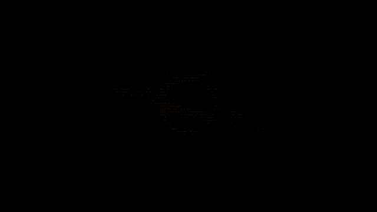
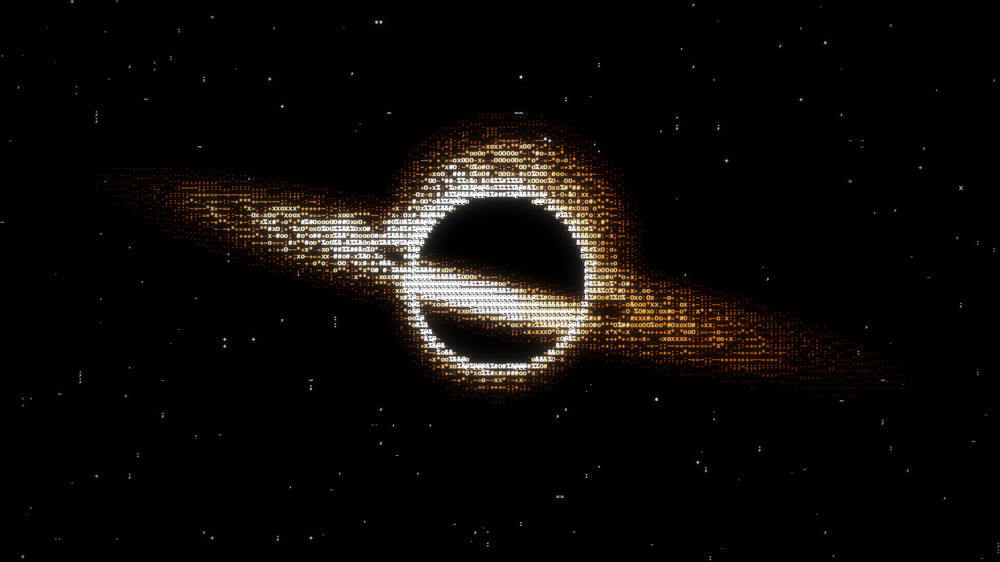
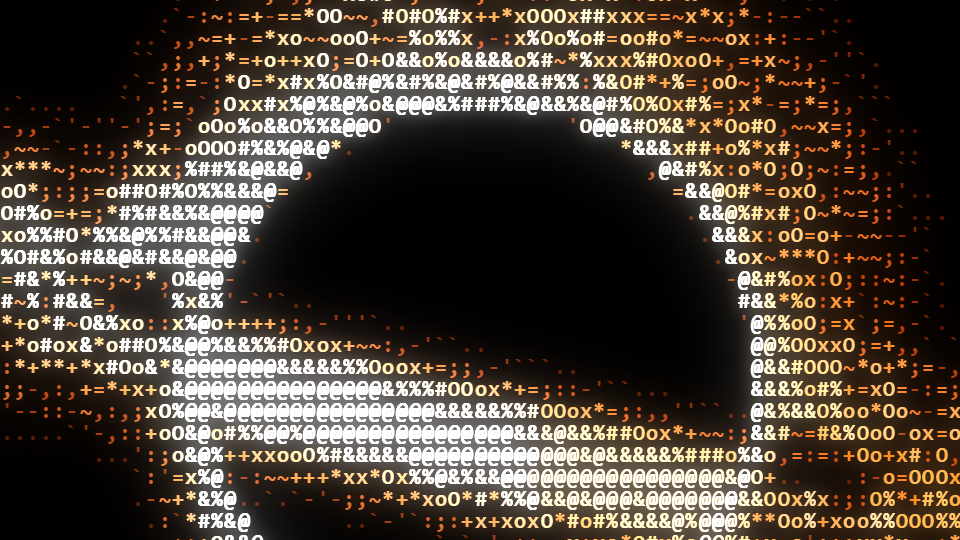
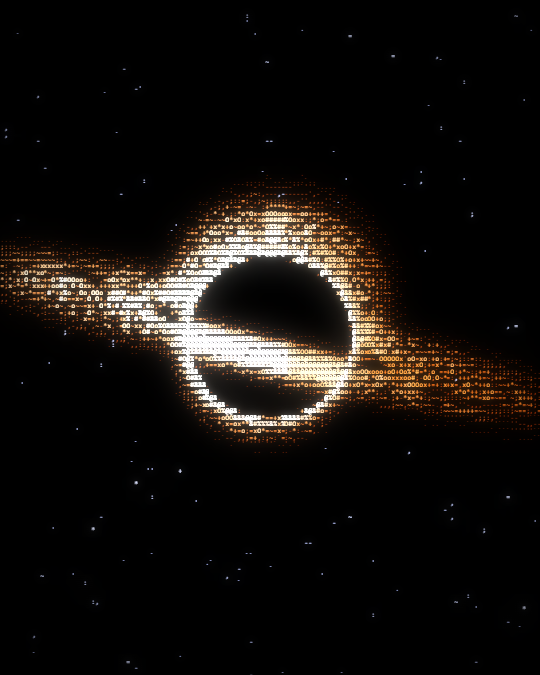
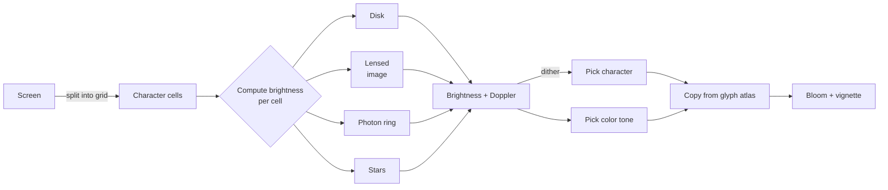

<div align="center">

# 🕳️ Gargantua — ASCII Black Hole

**One HTML file. Zero dependencies. A black hole drawn entirely with text characters.**

A real-time ASCII animation inspired by Gargantua from *Interstellar*, running right in your browser.




[Quick Start](#-quick-start) •
[Controls](#-controls) •
[Customization](#-customization) •
[How It Works](#-how-it-works) •
[FAQ](#-faq)

</div>

---

## 📸 Screenshots

<table>
  <tr>
    <td colspan="2"></td>
  </tr>
  <tr>
    <td width="60%"><br><sub>🔍 Up close, it's all characters: <code>.`'-,:;~=+*xoO#%&@</code></sub></td>
    <td width="40%"><br><sub>📱 4:5 app window opened by <code>start.bat</code> (made for Instagram)</sub></td>
  </tr>
</table>

---

## ✨ Features

| | Feature | What it does |
|:-:|---|---|
| 🌀 | **Accretion disk** | Inner rings spin faster than outer ones (Keplerian: `ω ∝ R^-1.5`) |
| 🔭 | **Gravitational lensing** | The far side of the disk wraps over and under the hole as bent arcs |
| 💍 | **Photon ring** | A thin, bright circle just outside the event horizon |
| 🔵🔴 | **Doppler beaming** | The approaching side is brighter and bluer, the receding side dimmer and redder |
| ✨ | **Warped starfield** | Background stars drift and twinkle as they bend around the hole |
| 🎬 | **Cinematic look** | 14° tilted framing, slow zoom, fade-in intro, bloom and vignette |

---

## 🚀 Quick Start

```bash
git clone https://github.com/musarda/gargantua-ascii.git
cd gargantua-ascii
```

<sub>No git? Click **Code → Download ZIP** at the top of this page and extract it.</sub>

Then pick **one of two ways**:

| Way | How | Best for |
|---|---|---|
| 🌍 **Browser** | Open `gargantua.html` in Chrome / Edge / Firefox / Safari | Everyone, any OS |
| 🪟 **App window** | Double-click `start.bat` | Windows: opens as a standalone app window with no address bar, ready for screen recording |

No install, no build step, no server.

> [!TIP]
> Skip the fade-in intro by adding `?t=20` to the URL:
> `gargantua.html?t=20` → the animation starts straight from second 20.

---

## 🎮 Controls

| Key | Action |
|:-:|---|
| <kbd>Space</kbd> | ⏯️ Pause / resume |
| <kbd>R</kbd> | 🔄 Restart |
| <kbd>F</kbd> | ⛶ Toggle fullscreen |

> [!NOTE]
> The mouse cursor is hidden over the page and the tab title is intentionally blank, so no UI shows up in your recordings.

---

## 🎨 Customization

### App window size and position → [`launch.ps1`](launch.ps1)

```powershell
$w = 540            # width (px)
$h = 675            # height (px)
$shiftLeft = 290    # shift left from center, 0 for dead center
```

<details>
<summary>📐 Ready-made aspect ratios</summary>

| Platform | Ratio | `$w` | `$h` |
|---|:-:|:-:|:-:|
| Instagram post | 4:5 | 540 | 675 |
| Instagram / TikTok story | 9:16 | 405 | 720 |
| YouTube / desktop | 16:9 | 1280 | 720 |
| Square | 1:1 | 600 | 600 |

</details>

### The animation itself → [`gargantua.html`](gargantua.html)

| Variable | Where | Effect |
|---|---|---|
| `RAMP` | top of script | Characters used (empty → dense) |
| `ROLL` | `-14 * Math.PI / 180` | Tilt of the frame |
| `STOPS` | color palette | Disk colors (dark orange → white) |
| `rs` | inside `frame()` | On-screen size of the black hole |
| `fs` | inside `build()` | Character size: smaller = more detail, slower |

> [!TIP]
> Changing `RAMP` gives a completely different vibe. `" .:-=+*#%@"` looks like classic ASCII art, while `" ░▒▓█"` gives a chunky block-pixel style.

---

## 🧠 How It Works



<details>
<summary><b>1. Grid and glyph atlas</b> — why is it fast?</summary>

<br>

Calling `fillText` thousands of times per frame is slow. Instead, `build()` draws every character **in 6 color tones** onto one hidden canvas (the atlas) at startup. During the animation, cells are simply copied from that atlas:

```js
actx.drawImage(atlas, idx * cwD, ti * chD, cwD, chD,   // character in the atlas
               x, y, cwD, chD);                        // cell on screen
```

The atlas is rebuilt whenever the window is resized.

</details>

<details>
<summary><b>2. Accretion disk</b> — drawing a tilted plane in 2D</summary>

<br>

The disk is a plane seen almost edge-on. Dividing the screen `v` coordinate by the tilt gives the disk's "depth" coordinate. Inner parts spinning faster comes from Kepler's law:

```js
const dz  = v / sinT;                       // screen → disk plane
const Rd  = Math.hypot(u, dz);              // radius on the disk
const om  = 1.1 * Math.pow(rIn / Rd, 1.5);  // angular velocity ∝ R^-1.5
```

The disk texture is built from layered sine waves at different frequencies (`texture()`).

</details>

<details>
<summary><b>3. Gravitational lensing</b> — the arc over the hole</summary>

<br>

In reality light bends, so the **back** of the disk appears above the hole. There's no ray tracing here. Instead, an analytic approximation works out which disk radius each point outside the hole "comes from". The upper and lower images are squeezed by different factors (`K = 3.6` / `9.0`).

</details>

<details>
<summary><b>4. Doppler and color</b> — why is one side brighter?</summary>

<br>

As the disk spins, one side moves toward us and the other away. `d = -u / R` gives that direction. It drives both brightness (`beam`) and the 6-level color tone (`ti`). The approaching side looks hotter and whiter, the receding side deeper orange.

</details>

<details>
<summary><b>5. Bloom</b> — the glow</summary>

<br>

The ASCII image is drawn three times on top of itself in `lighter` (additive) mode:

| Layer | Blur | Opacity |
|---|:-:|:-:|
| Wide halo | 16px | 60% |
| Near glow | 4px | 45% |
| Sharp characters | none | 100% |

Finally, a radial gradient darkens the edges (vignette).

</details>

---

## 📁 Files

```
📦 gargantua
 ┣ 📄 gargantua.html   → the whole animation (HTML + Canvas + JS)
 ┣ 📄 launch.ps1       → opens it as an app window (Windows)
 ┣ 📄 start.bat        → runs launch.ps1 on double-click
 ┣ 📂 assets           → README images
 ┣ 📄 SECURITY.md
 ┗ 📄 LICENSE
```

---

## ⚠️ Good to Know

> [!WARNING]
> **Performance:** Everything is computed on the CPU. On very large / 4K screens or slower machines the frame rate may drop. Shrinking the window or increasing `fs` in `build()` speeds it up.

> [!NOTE]
> The stars twinkle and the disk shimmers continuously. If you're sensitive to flickering visuals, press <kbd>Space</kbd> to pause at any time.

> [!IMPORTANT]
> **`launch.ps1` deletes one folder on every launch:** `%LOCALAPPDATA%\gargantua-profile`. It's a separate browser profile created just for this project, so the window always opens at the right size and position. Your regular Chrome/Edge profile, bookmarks and passwords are **never touched**.

> [!CAUTION]
> `start.bat` runs the script with `-ExecutionPolicy Bypass`. This applies **to that single run only** and does not change your system settings. Still, it's a good habit to read any `.bat` / `.ps1` you download before running it. The ones here are short and commented.

---

## 🔒 Privacy

| | |
|---|---|
| 🌐 Network requests | **None.** A Content-Security-Policy blocks all outside connections |
| 🍪 Cookies / storage | **None** |
| 📊 Tracking / analytics | **None** |
| 📦 External libraries | **None.** All code is in one readable file |

Details: [SECURITY.md](SECURITY.md)

---

## ❓ FAQ

<details>
<summary><b>Does it work on mobile?</b></summary>
<br>
Yes, it opens in any modern mobile browser. There's no keyboard, though, so pause / fullscreen aren't available, and it may stutter on weaker devices.
</details>

<details>
<summary><b>Is there an app window mode on macOS / Linux?</b></summary>
<br>
<code>start.bat</code> and <code>launch.ps1</code> are Windows-only. On other systems you can get the same effect with:
<pre>google-chrome --app="file://$PWD/gargantua.html" --window-size=540,675</pre>
</details>

<details>
<summary><b>How do I record it as a video?</b></summary>
<br>
Open the app window with <code>start.bat</code>, then record just that window with OBS or Xbox Game Bar (<kbd>Win</kbd>+<kbd>Alt</kbd>+<kbd>R</kbd>). The window is 4:5, so it's ready to upload to Instagram. Or press <kbd>F</kbd> for fullscreen and record the whole screen.
</details>

<details>
<summary><b>Is it scientifically accurate?</b></summary>
<br>
No, it's a <b>visual approximation</b>. There's no real ray tracing. Effects like Keplerian rotation, Doppler beaming and lensing are imitated with simple formulas so it can run in real time.
</details>

---

## 📜 License & Disclaimer

Released under the [MIT License](LICENSE). Use it, change it, share it.

<sub>*Interstellar* and *Gargantua* belong to their respective rights holders. This is an independent fan project with no affiliation to the film or its makers. No images, audio or other material from the film are used.</sub>

<div align="center">

⭐ If you enjoyed it, consider leaving a star!

</div>
